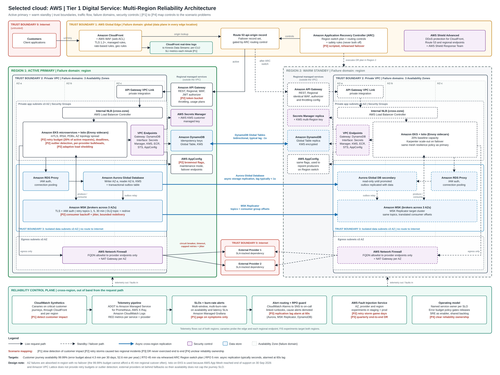

# CCOE SRE Assessment: Tier 1 Reliability Assessment

**Selected cloud: Amazon Web Services (AWS)**

Candidate: Andrew Lee | Submitted: 8 October 2026

This repository contains my response to the CCOE SRE assessment for a Tier 1 digital service running on CloudFront, API Gateway, EKS, MSK, Aurora and two external providers.

## Contents

| File | What it is |
| --- | --- |
| [Tier1-Reliability-Assessment-AWS.md](Tier1-Reliability-Assessment-AWS.md) | Full submission, readable directly on GitHub |
| [Tier1-Reliability-Assessment-AWS.pdf](Tier1-Reliability-Assessment-AWS.pdf) | Same submission as a PDF (A4) |
| [diagrams/tier1-aws-architecture.png](diagrams/tier1-aws-architecture.png) | Mandatory architecture diagram, full resolution (4800 x 3600 px) |
| [diagrams/tier1-aws-architecture.svg](diagrams/tier1-aws-architecture.svg) | Same diagram as scalable vector graphics |
| [diagrams/tier1-aws-architecture-A3.pdf](diagrams/tier1-aws-architecture-A3.pdf) | Same diagram on one A3 landscape page, for printing |
| [AI-Usage-and-Contribution-Report.md](AI-Usage-and-Contribution-Report.md) | Disclosure of AI assistance and contributions |
| [AI-Usage-and-Contribution-Report.pdf](AI-Usage-and-Contribution-Report.pdf) | Same report as a PDF (A4) |

## Required deliverables

| Required deliverable | Section in the submission |
| --- | --- |
| Service reliability model | Service reliability model (Task 1) |
| SLI/SLO specification | SLI/SLO specification and error budget policy (Task 1) |
| Observability and resilience architecture | Parts 1 and 2 (Tasks 2 and 3) |
| DR runbook and game-day plan | DR runbook and game-day plan (Task 4) |
| Incident command model | Incident command model (Task 5) |
| Prioritized 90-day roadmap | Prioritized 90-day roadmap (Task 6) |
| Mandatory architecture diagram | Mandatory architecture diagram (AWS), and the `diagrams` folder |

## Key targets

- Customer journey availability: 99.99% (about 4.3 minutes of error budget per 30 days)
- RTO: 45 minutes, through a rehearsed ARC Region switch plan to a warm standby Region
- RPO: 5 minutes for the critical data set, with replication lag alarmed at 60 seconds

## AI assistance

This submission was prepared with AI assistance (Claude by Anthropic and Gemini by Google). The disclosure is in the Assumptions and exclusions section of the submission, and the full breakdown is in the AI Usage and Contribution Report.
